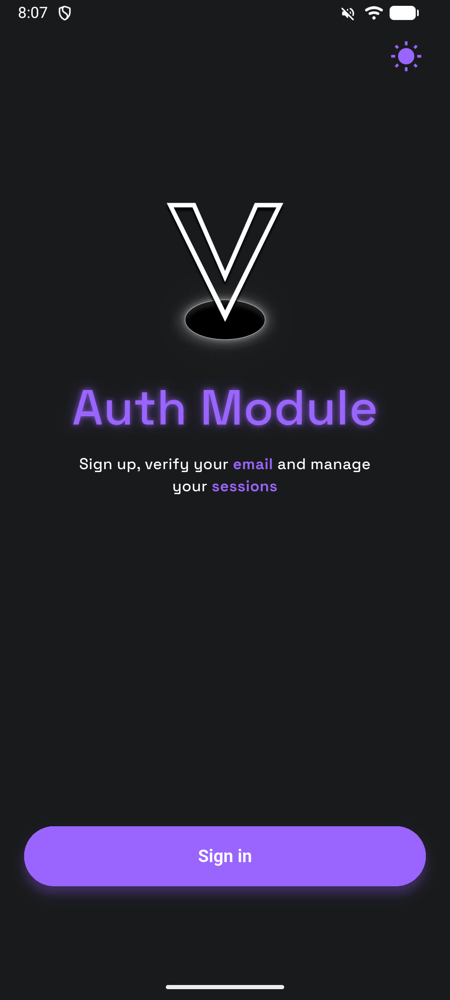
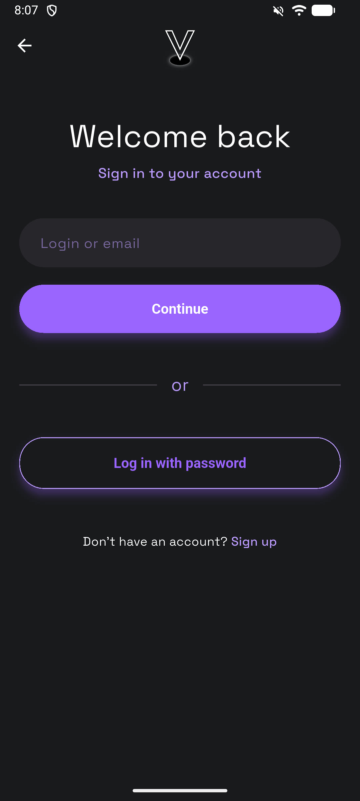
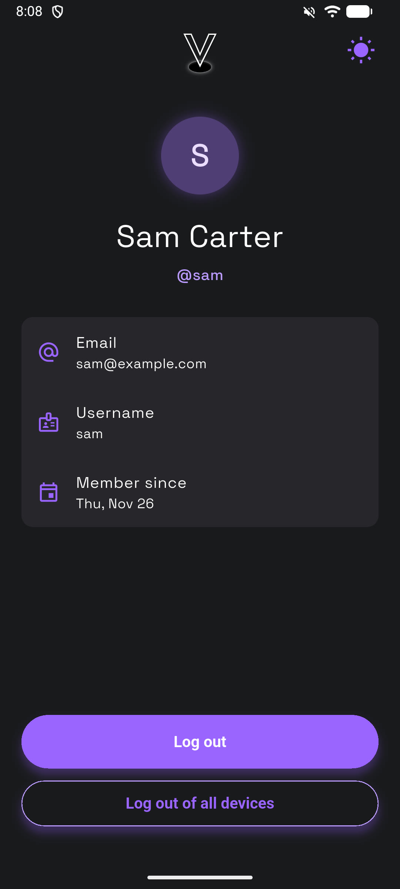
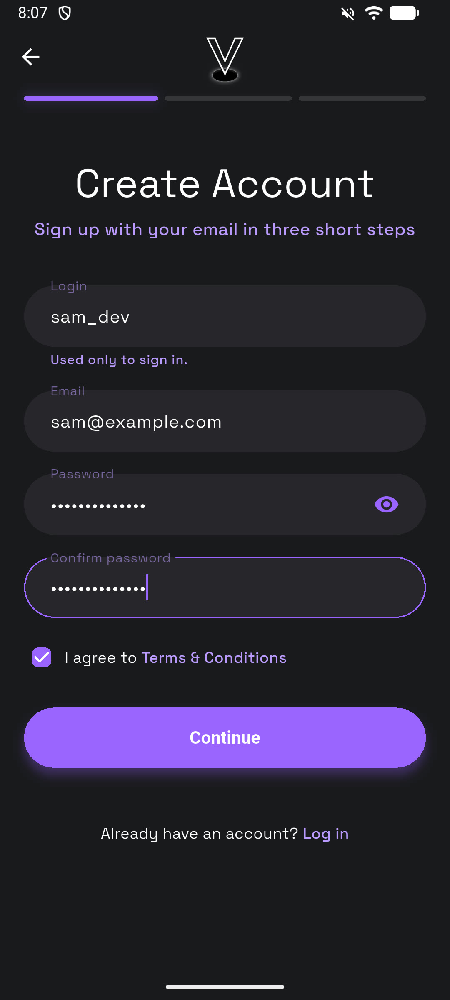
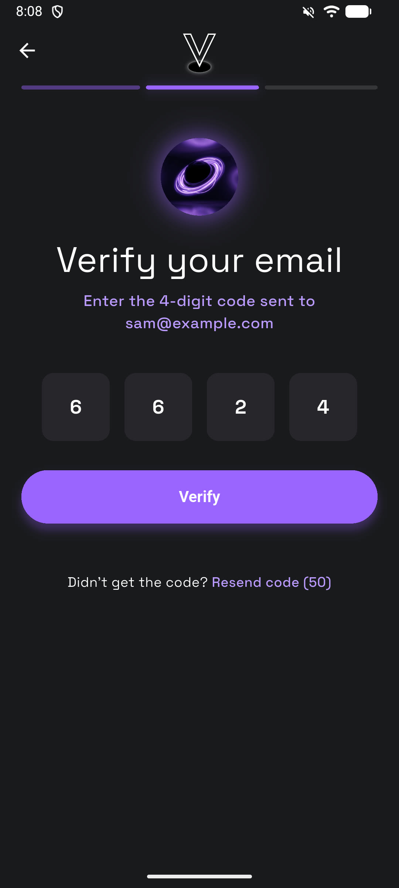
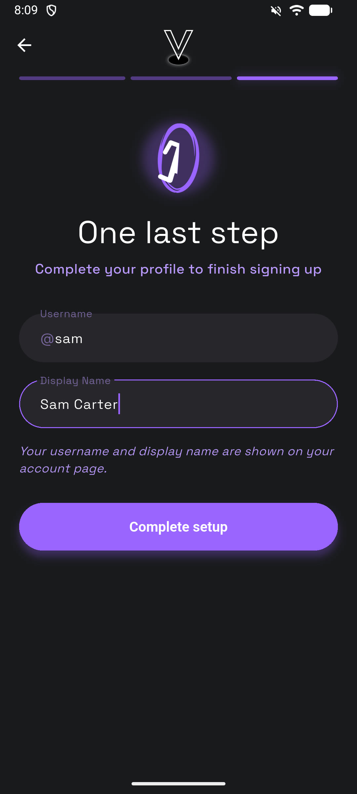
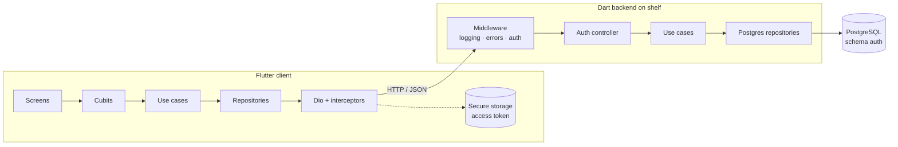

<div align="center">

# Flutter Shelf Auth Module

**Sign-up and sign-in for a mobile app: a Flutter client and a Dart backend on shelf with PostgreSQL, started with one Docker Compose command.**

[](https://flutter.dev)
[](https://dart.dev)
[](https://pub.dev/packages/shelf)
[](https://www.postgresql.org)
[](docker/docker-compose.yml)
[](#testing)
[](LICENSE)

Client tested on Android

**English** · [Русский](README.ru.md)

</div>

## Demo

https://github.com/user-attachments/assets/5833eeea-9a71-40f2-94ed-50160a5bd5c0

## Screenshots

| | | |
|:---:|:---:|:---:|
|  |  |  |
| Welcome | Sign in by login or e-mail | Account: profile and sessions |
|  |  |  |
| Registration 1/3: credentials | Registration 2/3: e-mail code | Registration 3/3: public profile |

## What the module does

**Registration in three steps.** The user enters a login, e-mail and password, confirms the e-mail with a 4-digit code, then chooses a public username and display name. The account is created only after the last step. Until then the data sits in a separate pending-registrations table, and leaving the profile step cancels the registration on the server.

**Two ways to sign in.** By login or e-mail plus password, or by a one-time code sent to the e-mail.

**Sessions.** A successful sign-in returns an access token valid for 30 days. The account screen shows the current user and can end the current session or every session of the user on all devices.

**E-mail codes.** A code is valid for 15 minutes, can be requested again after 60 seconds, and allows 5 wrong attempts. The client shows a separate message for a wrong code, an expired code and too many attempts.

**Session check on launch.** The client checks the saved token against the server. If the server answers `401`, the user goes to the sign-in screen. If the server is unreachable, the session is kept and the app offers to retry.

**Client.** Russian and English, chosen by the device language. Light and dark theme with a switch in the app; the choice is saved between launches. The theme layer has five built-in color palettes; the active one is set in code, so the app can be rebranded without touching the screens.

## Out of scope

- **Sending e-mail.** The backend writes codes to its log. A real sender (SMTP or a mail API) plugs in by implementing `EmailCodeSenderService` and registering it instead of `DevEmailSender`; the rest of the code does not change.
- **Password recovery.** The "Forgot password?" link shows a "not available in this demo" message.
- **Refresh tokens and JWT.** Sessions are server-side; the reasons are in [Architecture](#architecture).
- **Social sign-in** (Google, Apple) and two-factor authentication.

## Quick start

Requirements: Docker, Flutter SDK, an Android emulator or phone.

**1. Backend and database**

```bash
cd docker
cp .env.example .env          # DB name, user and password
docker compose up --build
```

Compose starts PostgreSQL 16 and the backend on port `8082`. On the first start (empty volume) PostgreSQL applies the SQL migrations from `backend/migrations`. The backend waits for the database healthcheck before it starts. If port 5432 is taken on the host, set `DB_HOST_PORT` in `.env`.

E-mail codes appear in the backend log:

```bash
docker compose logs -f backend
```

**2. Client**

```bash
cd frontend
flutter pub get
flutter run                   # Android emulator: http://10.0.2.2:8082 by default
```

On a physical phone connected over USB, forward the port and point the app at it:

```bash
adb reverse tcp:8082 tcp:8082
flutter run --dart-define=API_BASE_URL=http://127.0.0.1:8082
```

Generated code (`freezed`, `injectable`, `auto_route`, l10n) is committed, so `build_runner` is not needed to run the project.

## Architecture



Both sides use the same feature-first layering: `api` or `presentation`, `domain`, `data`. Each auth action on the server is a separate use case (`StartRegistration`, `VerifyRegistrationEmail`, `LoginWithPassword`, `Logout` and so on) behind a repository interface. Dependencies are wired with `get_it` and `injectable` on both sides.

### Key decisions

**Opaque session tokens instead of JWT.** A token is 32 random bytes from a cryptographic generator. The client gets the token itself; the database keeps only its SHA-256 hash, so a database leak does not expose working tokens. Every request checks the session in the database, which makes logout immediate: a revoked session stops working on the next request, and "log out of all devices" deletes every session of the user in one query. JWT would save that database lookup, but revoking it before expiry needs a denylist, and the module would also need refresh tokens. For one backend and one client a server-side session is simpler and safer.

**Argon2id for passwords and e-mail codes.** Passwords are hashed with a random salt. E-mail codes are stored as hashes too, so the codes table cannot be used to sign in.

**Plain SQL, no ORM.** Queries use named parameters through the `postgres` driver, so values never get concatenated into SQL. `RETURNING` avoids a second round trip after inserts. PostgreSQL error codes are mapped to domain errors: a unique violation on e-mail becomes `EMAIL_TAKEN`, not a 500.

**Pending registration as a separate table.** An unconfirmed sign-up never creates a row in `auth.users`, so the users table holds no half-created accounts.

**One error format.** Every error is `{ success: false, error: { code, message, details? } }`. Malformed requests (`INVALID_JSON`, `INVALID_BODY`) are separated from validation errors (`VALIDATION_FAILED`), and validation returns all field errors at once, so the client can mark every wrong field in one pass.

**Session expiry handled in the network layer.** A route guard only runs on navigation, so an expired token is caught by the Dio error interceptor: a `401` on a protected request calls `ISessionExpiredHandler`, which signs the user out. Sign-in requests are excluded, so a wrong password does not trigger a logout.

**Configuration from the environment.** The production entry point `bin/server.dart` reads the database settings and port from environment variables; Docker Compose passes them from `.env`. The backend image is a native executable compiled with `dart compile exe` on a `scratch` base.

**Graceful shutdown.** On `SIGINT` or `SIGTERM` the server stops accepting requests and closes the connection pool.

## Security

| Threat | Measure |
|---|---|
| Database leak | Passwords and e-mail codes are hashed with Argon2id; session tokens are stored as SHA-256 hashes |
| Code guessing | 5 attempts per code, 15-minute lifetime, codes are generated with `Random.secure()` |
| Code flooding | A new code can be requested no earlier than 60 seconds after the previous one (`429`) |
| Stolen token | Sessions are checked in the database on every request; "log out of all devices" revokes them at once |
| Token on the device | The client keeps the token in `flutter_secure_storage` (Keychain on iOS, encrypted storage on Android) |
| SQL injection | Only parameterized queries |
| Bypassing the client | The server validates every field again; client validation is for UX only. Reserved logins and usernames are rejected by blacklists |

## API

Base URL `http://localhost:8082`. Bodies are JSON. Protected endpoints need `Authorization: Bearer <access_token>`.

| Method | Path | Auth | Purpose |
|---|---|:---:|---|
| POST | `/auth/register/start` | | Create a pending registration, send a code |
| POST | `/auth/register/verify-email` | | Confirm the code |
| POST | `/auth/register/complete-profile` | | Set username and display name, create the user |
| POST | `/auth/register/cancel` | | Drop a pending registration |
| POST | `/auth/login/password` | | Sign in by login or e-mail and password |
| POST | `/auth/login/code/request` | | Send a one-time sign-in code |
| POST | `/auth/login/code/verify` | | Exchange the code for a session |
| GET | `/auth/me` | Bearer | Current user |
| POST | `/auth/logout` | Bearer | End the current session |
| POST | `/auth/logout/all` | Bearer | End all sessions of the user |
| GET | `/health` | | Health check |

Error format:

```json
{
  "success": false,
  "error": {
    "code": "VALIDATION_FAILED",
    "message": "Some fields are invalid",
    "details": [
      { "field": "password", "code": "INVALID_PASSWORD", "message": "..." }
    ]
  }
}
```

Request and response examples for every endpoint are in [backend/README.md](backend/README.md). A Postman collection is in [backend/postman](backend/postman).

## Client

- **State:** Cubit (`flutter_bloc`). `AuthCubit` owns the session; sign-in, registration and the account screen each have their own cubit.
- **Navigation:** `auto_route` with `AuthGuard`. A signed-out user is sent to the welcome screen and cannot open the account screen.
- **Network:** `dio` with two interceptors. `AuthInterceptor` adds the token; `ErrorInterceptor` turns HTTP and network errors into typed failures and handles an expired session.
- **Screens:** welcome, sign-in by code and by password, three registration steps with a progress indicator, account. All auth screens share one layout with header, body and footer slots.
- **Codes:** a PIN field (`pinput`) and a resend button with a countdown.
- **DI:** `get_it` + `injectable`.

## Testing

```bash
cd backend
dart test
```

59 unit tests in 13 files; none of them needs a database:

- every auth endpoint, run through the real router and middleware with fake use cases: status codes, response bodies, error codes;
- profile input validation;
- the auth middleware on public and protected routes;
- reading the configuration from environment variables;
- the DI module.

The full flow (registration → code from the log → profile → sign-in → `/auth/me` → logout → `401`) was checked by hand against the Docker setup. The Flutter client has no automated tests.

## Using it in your project

1. **E-mail.** Implement `EmailCodeSenderService` with your SMTP or mail API and register it instead of `DevEmailSender` (`backend/lib/src/features/auth/shared/verify-email/domain/services/`).
2. **Configuration.** Database settings and port come from environment variables; see [docker/.env.example](docker/.env.example).
3. **After sign-in.** After sign-in the user lands on the account screen (`frontend/lib/features/account/`); replace it with your app's home screen in `frontend/lib/router/`.
4. **Branding.** App name, icon (`frontend/flutter_launcher_icons.yaml`), palette (`frontend/lib/core/theme/palette/`), texts in `frontend/lib/core/l10n/*.arb`.
5. **Schema changes.** Add a new `backend/migrations/0004_*.sql`; applied migrations are not edited.

## Tech stack

| Area | Technologies |
|---|---|
| Client | Flutter, `flutter_bloc` (Cubit), `auto_route`, `dio`, `get_it` + `injectable`, `flutter_secure_storage`, `shared_preferences`, `freezed`, `json_serializable`, `pinput`, `talker` |
| Localization | `flutter_localizations`, `intl`, ARB files |
| Server | Dart 3.11, `shelf`, `shelf_router`, `postgres` (connection pool), `argon2`, `crypto`, `get_it` + `injectable`, `talker` |
| Database | PostgreSQL 16, SQL migrations |
| Infrastructure | Docker Compose, multi-stage Dockerfile (`dart compile exe` → `scratch`) |
| Quality | `test`, `lints`, `flutter_lints`, Postman |

## Project structure

```
.
├── backend/
│   ├── bin/
│   │   ├── server.dart          # production entry point, config from env
│   │   └── server.dev.dart      # local development entry point
│   ├── lib/src/
│   │   ├── core/                # config, DI, JSON responses, errors, Postgres error mapping
│   │   ├── middleware/          # logging, errors, auth
│   │   └── features/auth/       # register, login, logout, me: api / domain / data
│   ├── migrations/              # 0001–0003, SQL
│   ├── postman/                 # collections and environment
│   ├── test/unit/
│   └── Dockerfile
├── frontend/
│   └── lib/
│       ├── app/                 # root widget, providers
│       ├── router/              # auto_route, AuthGuard
│       ├── core/                # network, storage, theme and palettes, l10n, layouts, DI
│       └── features/
│           ├── auth/            # welcome, login, register, session
│           └── account/         # account screen
├── docker/                      # docker-compose.yml, .env.example
└── project_screenshots/
```

## License

[MIT](LICENSE)
