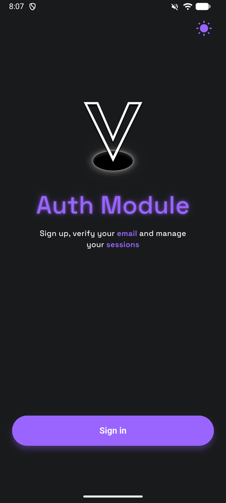
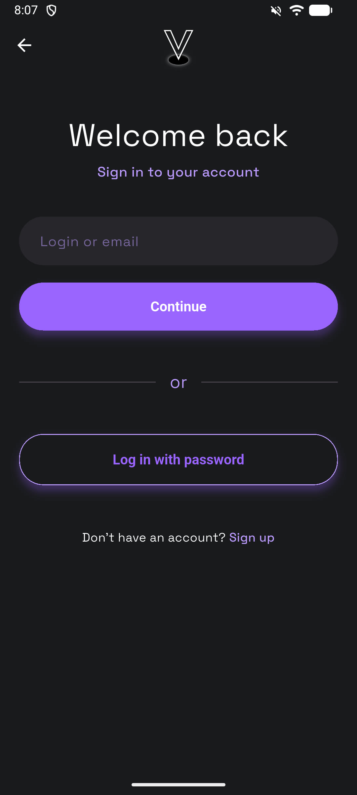
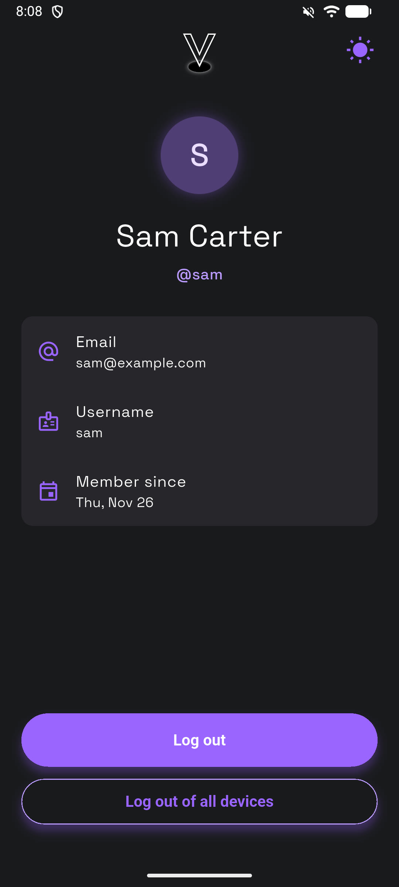
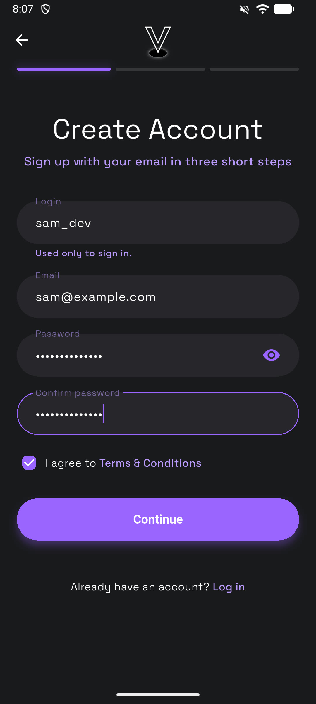
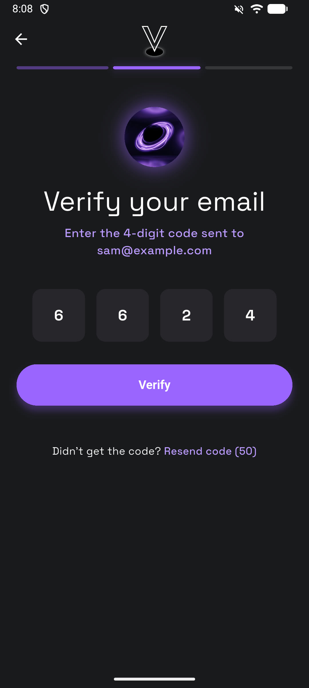
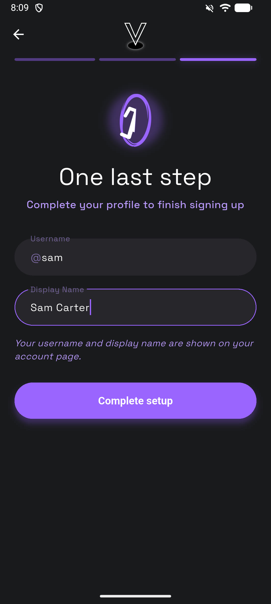
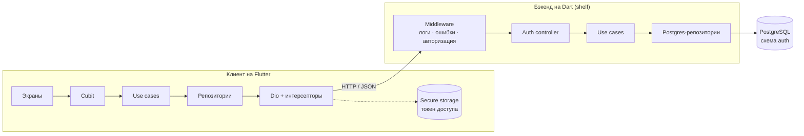

<div align="center">

# Flutter Shelf Auth Module

**Регистрация и вход для мобильного приложения: клиент на Flutter и бэкенд на Dart (shelf) с PostgreSQL. Запускается одной командой Docker Compose.**

[](https://flutter.dev)
[](https://dart.dev)
[](https://pub.dev/packages/shelf)
[](https://www.postgresql.org)
[](docker/docker-compose.yml)
[](#тестирование)
[](LICENSE)

Клиент проверен на Android

<a href="README.md"></a>

</div>

## Демо

https://github.com/user-attachments/assets/cf8d6a7d-4c13-4d08-b49c-987506a79b84

## Скриншоты

| | | |
|:---:|:---:|:---:|
|  |  |  |
| Приветствие | Вход по логину или e-mail | Аккаунт: профиль и сессии |
|  |  |  |
| Регистрация 1/3: данные для входа | Регистрация 2/3: код из письма | Регистрация 3/3: публичный профиль |

## Что умеет модуль

**Регистрация в три шага.** Пользователь вводит логин, e-mail и пароль, подтверждает почту 4-значным кодом, затем выбирает публичное имя пользователя и отображаемое имя. Аккаунт создаётся только после последнего шага. До этого данные лежат в отдельной таблице незавершённых регистраций, а уход с шага профиля отменяет регистрацию на сервере.

**Два способа входа.** По логину или e-mail с паролем либо по одноразовому коду, который приходит на почту.

**Сессии.** После входа клиент получает токен доступа на 30 дней. Экран аккаунта показывает текущего пользователя и позволяет завершить текущую сессию или все сессии на всех устройствах.

**Коды из писем.** Код действует 15 минут, новый можно запросить через 60 секунд, на ввод даётся 5 попыток. Для неверного кода, истёкшего кода и превышения попыток клиент показывает разные сообщения.

**Проверка сессии при запуске.** Клиент сверяет сохранённый токен с сервером. Если сервер отвечает `401`, пользователь попадает на экран входа. Если сервер недоступен, сессия сохраняется, а приложение предлагает повторить попытку.

**Клиент.** Русский и английский, язык берётся из настроек устройства. Светлая и тёмная тема с переключателем в приложении, выбор сохраняется между запусками. В слое темы пять готовых цветовых палитр. Активная задаётся в коде, поэтому приложение можно перекрасить под другой бренд, не трогая экраны.

## Что не входит в модуль

- **Отправка писем.** Бэкенд пишет коды в лог. Настоящий отправитель (SMTP или почтовый API) подключается реализацией `EmailCodeSenderService`, которая регистрируется вместо `DevEmailSender`. Остальной код при этом не меняется.
- **Восстановление пароля.** Ссылка «Забыли пароль?» показывает сообщение, что в демо-версии функция недоступна.
- **Refresh-токены и JWT.** Сессии хранятся на сервере, причины описаны в разделе [Архитектура](#архитектура).
- **Вход через соцсети** (Google, Apple) и двухфакторная аутентификация.

## Быстрый старт

Нужны Docker, Flutter SDK и эмулятор Android или телефон.

**1. Бэкенд и база данных**

```bash
cd docker
cp .env.example .env          # имя БД, пользователь и пароль
docker compose up --build
```

Compose запускает PostgreSQL 16 и бэкенд на порту `8082`. При первом запуске (пустой volume) PostgreSQL применяет SQL-миграции из `backend/migrations`. Бэкенд стартует только после того, как база прошла healthcheck. Если порт 5432 на хосте занят, задайте `DB_HOST_PORT` в `.env`.

Коды из писем видны в логе бэкенда:

```bash
docker compose logs -f backend
```

**2. Клиент**

```bash
cd frontend
flutter pub get
flutter run                   # эмулятор Android: по умолчанию http://10.0.2.2:8082
```

На телефоне, подключённом по USB, пробросьте порт и укажите адрес приложению:

```bash
adb reverse tcp:8082 tcp:8082
flutter run --dart-define=API_BASE_URL=http://127.0.0.1:8082
```

Сгенерированный код (`freezed`, `injectable`, `auto_route`, l10n) лежит в репозитории, поэтому для запуска `build_runner` не нужен.

## Архитектура



Обе стороны разбиты по фичам и слоям одинаково: `api` или `presentation`, `domain`, `data`. Каждое действие на сервере вынесено в отдельный use case (`StartRegistration`, `VerifyRegistrationEmail`, `LoginWithPassword`, `Logout` и другие) за интерфейсом репозитория. Зависимости на обеих сторонах собираются через `get_it` и `injectable`.

### Ключевые решения

**Непрозрачные токены сессий вместо JWT.** Токен состоит из 32 случайных байтов от криптографического генератора. Клиент получает сам токен, а в базе хранится только его SHA-256-хэш, поэтому утечка базы не даёт рабочих токенов. Сессия проверяется в базе при каждом запросе, так что выход срабатывает сразу: отозванная сессия перестаёт работать на следующем же запросе, а «выйти на всех устройствах» удаляет все сессии пользователя одним запросом. JWT избавил бы от обращения к базе, но для досрочного отзыва ему нужен список отозванных токенов, а модулю понадобились бы ещё и refresh-токены. Для одного бэкенда и одного клиента серверная сессия проще и надёжнее.

**Argon2id для паролей и кодов из писем.** Пароли хэшируются со случайной солью. Коды из писем тоже хранятся в виде хэшей, поэтому по таблице кодов войти нельзя.

**Чистый SQL без ORM.** Запросы используют именованные параметры драйвера `postgres`, значения никогда не склеиваются с текстом SQL. `RETURNING` избавляет от второго запроса после вставки. Коды ошибок PostgreSQL переводятся в доменные ошибки: нарушение уникальности e-mail превращается в `EMAIL_TAKEN`, а не в 500.

**Незавершённая регистрация в отдельной таблице.** Неподтверждённая регистрация не создаёт строку в `auth.users`, поэтому в таблице пользователей не бывает полусозданных аккаунтов.

**Единый формат ошибок.** Любая ошибка имеет вид `{ success: false, error: { code, message, details? } }`. Некорректные запросы (`INVALID_JSON`, `INVALID_BODY`) отделены от ошибок валидации (`VALIDATION_FAILED`), а валидация возвращает ошибки по всем полям сразу, чтобы клиент мог подсветить их за один раз.

**Истечение сессии обрабатывается в сетевом слое.** Guard маршрута срабатывает только при навигации, поэтому истёкший токен ловит интерсептор ошибок Dio: `401` на защищённом запросе вызывает `ISessionExpiredHandler`, и пользователь выходит из аккаунта. Запросы входа исключены, поэтому неверный пароль не приводит к выходу.

**Конфигурация из окружения.** Production-точка входа `bin/server.dart` читает настройки базы и порт из переменных окружения, Docker Compose передаёт их из `.env`. Образ бэкенда содержит нативный бинарник, собранный `dart compile exe`, на базе `scratch`.

**Корректная остановка.** По `SIGINT` или `SIGTERM` сервер перестаёт принимать запросы и закрывает пул соединений.

## Безопасность

| Угроза | Мера |
|---|---|
| Утечка базы | Пароли и коды из писем хэшируются Argon2id, токены сессий хранятся как SHA-256-хэши |
| Подбор кода | 5 попыток на код, срок жизни 15 минут, коды генерируются через `Random.secure()` |
| Засыпание кодами | Новый код можно запросить не раньше чем через 60 секунд после предыдущего (`429`) |
| Украденный токен | Сессия проверяется в базе при каждом запросе, «выйти на всех устройствах» отзывает все сессии сразу |
| Токен на устройстве | Клиент хранит токен в `flutter_secure_storage` (Keychain на iOS, зашифрованное хранилище на Android) |
| SQL-инъекции | Только параметризованные запросы |
| Обход клиента | Сервер заново проверяет каждое поле, валидация на клиенте нужна только для удобства. Зарезервированные логины и имена пользователей отсекаются чёрными списками |

## API

Базовый адрес `http://localhost:8082`. Тела запросов в JSON. Защищённым эндпоинтам нужен заголовок `Authorization: Bearer <access_token>`.

| Метод | Путь | Авторизация | Назначение |
|---|---|:---:|---|
| POST | `/auth/register/start` | | Создать незавершённую регистрацию, отправить код |
| POST | `/auth/register/verify-email` | | Подтвердить код |
| POST | `/auth/register/complete-profile` | | Задать имя пользователя и отображаемое имя, создать пользователя |
| POST | `/auth/register/cancel` | | Удалить незавершённую регистрацию |
| POST | `/auth/login/password` | | Вход по логину или e-mail и паролю |
| POST | `/auth/login/code/request` | | Отправить одноразовый код для входа |
| POST | `/auth/login/code/verify` | | Обменять код на сессию |
| GET | `/auth/me` | Bearer | Текущий пользователь |
| POST | `/auth/logout` | Bearer | Завершить текущую сессию |
| POST | `/auth/logout/all` | Bearer | Завершить все сессии пользователя |
| GET | `/health` | | Проверка работоспособности |

Формат ошибки:

```json
{
  "success": false,
  "error": {
    "code": "VALIDATION_FAILED",
    "message": "Some fields are invalid",
    "details": [
      { "field": "password", "code": "INVALID_PASSWORD", "message": "..." }
    ]
  }
}
```

Примеры запросов и ответов для каждого эндпоинта есть в [backend/README.md](backend/README.md), коллекция Postman лежит в [backend/postman](backend/postman).

## Клиент

- **Состояние:** Cubit (`flutter_bloc`). `AuthCubit` отвечает за сессию, у входа, регистрации и экрана аккаунта свои кубиты.
- **Навигация:** `auto_route` с `AuthGuard`. Пользователь без сессии попадает на приветственный экран и не может открыть экран аккаунта.
- **Сеть:** `dio` с двумя интерсепторами. `AuthInterceptor` добавляет токен, `ErrorInterceptor` превращает HTTP- и сетевые ошибки в типизированные и обрабатывает истёкшую сессию.
- **Экраны:** приветствие, вход по коду и по паролю, три шага регистрации с индикатором прогресса, аккаунт. Все экраны авторизации используют общий макет со слотами header, body и footer.
- **Коды:** поле PIN (`pinput`) и кнопка повторной отправки с обратным отсчётом.
- **DI:** `get_it` + `injectable`.

## Тестирование

```bash
cd backend
dart test
```

59 юнит-тестов в 13 файлах, ни одному не нужна база данных:

- каждый эндпоинт авторизации прогоняется через настоящий роутер и middleware с фейковыми use cases: коды ответа, тела ответов, коды ошибок;
- валидация данных профиля;
- middleware авторизации на публичных и защищённых маршрутах;
- чтение конфигурации из переменных окружения;
- DI-модуль.

Полный сценарий (регистрация → код из лога → профиль → вход → `/auth/me` → выход → `401`) проверен вручную на Docker-сборке. Автотестов у Flutter-клиента нет.

## Как встроить в свой проект

1. **Почта.** Реализуйте `EmailCodeSenderService` через свой SMTP или почтовый API и зарегистрируйте вместо `DevEmailSender` (`backend/lib/src/features/auth/shared/verify-email/domain/services/`).
2. **Конфигурация.** Настройки базы и порт берутся из переменных окружения, см. [docker/.env.example](docker/.env.example).
3. **После входа.** Пользователь попадает на экран аккаунта (`frontend/lib/features/account/`). Замените его на главный экран своего приложения в `frontend/lib/router/`.
4. **Брендинг.** Название приложения, иконка (`frontend/flutter_launcher_icons.yaml`), палитра (`frontend/lib/core/theme/palette/`), тексты в `frontend/lib/core/l10n/*.arb`.
5. **Изменения схемы.** Добавьте новый файл `backend/migrations/0004_*.sql`. Уже применённые миграции не редактируются.

## Стек

| Область | Технологии |
|---|---|
| Клиент | Flutter, `flutter_bloc` (Cubit), `auto_route`, `dio`, `get_it` + `injectable`, `flutter_secure_storage`, `shared_preferences`, `freezed`, `json_serializable`, `pinput`, `talker` |
| Локализация | `flutter_localizations`, `intl`, ARB-файлы |
| Сервер | Dart 3.11, `shelf`, `shelf_router`, `postgres` (пул соединений), `argon2`, `crypto`, `get_it` + `injectable`, `talker` |
| База данных | PostgreSQL 16, SQL-миграции |
| Инфраструктура | Docker Compose, многоэтапный Dockerfile (`dart compile exe` → `scratch`) |
| Качество | `test`, `lints`, `flutter_lints`, Postman |

## Структура проекта

```
.
├── backend/
│   ├── bin/
│   │   ├── server.dart          # production-точка входа, конфиг из env
│   │   └── server.dev.dart      # точка входа для локальной разработки
│   ├── lib/src/
│   │   ├── core/                # конфиг, DI, JSON-ответы, ошибки, разбор ошибок Postgres
│   │   ├── middleware/          # логи, ошибки, авторизация
│   │   └── features/auth/       # register, login, logout, me: api / domain / data
│   ├── migrations/              # 0001–0003, SQL
│   ├── postman/                 # коллекции и окружение
│   ├── test/unit/
│   └── Dockerfile
├── frontend/
│   └── lib/
│       ├── app/                 # корневой виджет, провайдеры
│       ├── router/              # auto_route, AuthGuard
│       ├── core/                # сеть, хранилища, тема и палитры, l10n, макеты, DI
│       └── features/
│           ├── auth/            # приветствие, вход, регистрация, сессия
│           └── account/         # экран аккаунта
├── docker/                      # docker-compose.yml, .env.example
└── project_screenshots/
```

## Лицензия

[MIT](LICENSE)
